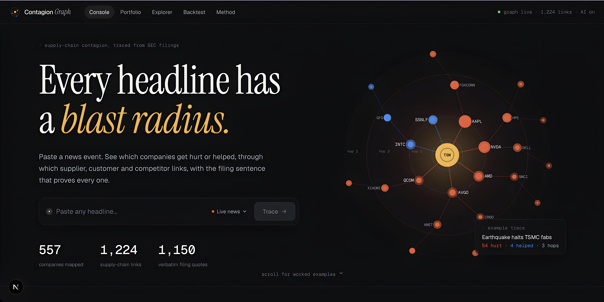
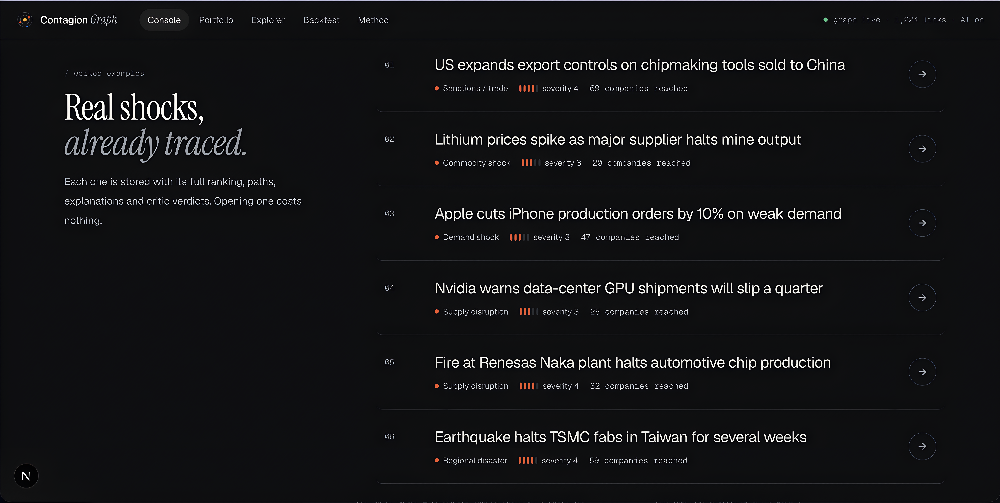
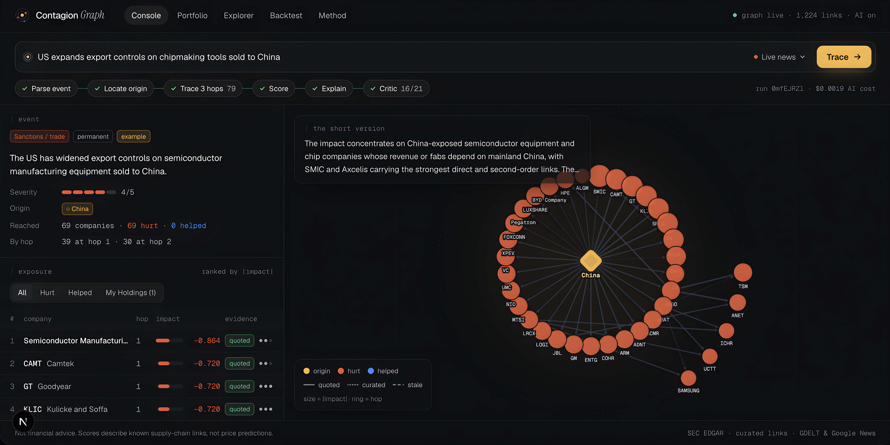

# Contagion Graph

Paste a headline and see which companies get hurt or helped, through which supplier, customer, competitor,
region and commodity links, and how badly. The filing sentence behind every link is shown with the result.

Plain RAG retrieves documents; this retrieves consequences. An offline loop turns SEC filings into a graph of
evidence-backed links. An online loop parses each headline, traces it up to three hops through that graph,
scores every company with a deterministic formula, and explains the top paths with citations. A critic agent
checks each cited claim before the result is shown.

```
offline:  EDGAR 10-K/20-F ─► passage filter ─► Extractor (Claude, Batch API) ─► verbatim-quote check
          ─► Entity resolver ─► graph (Postgres) + curated seed links

online:   headline ─► Event parser ─► origins ─► Navigator (templates) ─► Scorer (Python)
          ─► Explainer (GraphRAG over edge quotes) ─► Critic ─► UI
```

## Screenshots

### 1. Radial Shock Diffusion & Landing Console

*Concentric radial contagion network graph showing multi-hop shock diffusion outward from TSMC (TSM).*

### 2. Multi-Hop Trace Execution Console

*Live execution trace on US-China chipmaking tool export controls (`run 0mfEJRZl`): 6-stage pipeline chips, event taxonomy card, radial graph, and ranked exposure table with cited SEC 10-K quotes.*

### 3. Pre-Indexed Worked Examples Library

*Catalog of pre-computed historical shocks (Taiwan earthquake, Renesas plant fire, lithium mining halts, Apple order cuts) for instant zero-cost review.*

## Stack

| Layer | Choice |
|---|---|
| Frontend | Next.js 15 (App Router), Tailwind v4, Cytoscape.js |
| API | FastAPI, served as a Vercel Python function at `/api/py/*` |
| Graph + evidence | Postgres on Neon (SQLite locally); traversal in Python, in memory |
| LLM | Claude Haiku 5.5 for extraction (Batch API), event parsing, explanation and critic |
| Data | SEC EDGAR, GDELT + Google News (live headlines), Yahoo Finance (back-tests) |

## Run locally

Requires Python 3.12 and Node 20+.

```bash
uv venv .venv --python 3.12
uv pip install --python .venv/Scripts/python.exe -r requirements-dev.txt   # macOS/Linux: .venv/bin/python
npm install
```

Create `.env.local`:

```
ANTHROPIC_API_KEY=sk-ant-...
SEC_USER_AGENT=Your Name you@example.com
CG_ADMIN_TOKEN=pick-a-secret
```

Start both servers (two terminals):

```bash
npm run dev:api     # FastAPI on :8000
npm run dev         # Next.js on :3000 (proxies /api/py to :8000)
```

The repo ships with a built graph in `data/contagion.db`, so this works without rebuilding anything.

## Build the graph from scratch

```bash
python -m scripts.build_universe        # companies, aliases, regions, commodities
python -m scripts.fetch_filings         # latest annual report per SEC filer (~60 MB, not committed)
python -m scripts.extract estimate      # cost estimate, no spend
python -m scripts.extract submit        # one Batch API job for all filings (~$0.15 on Haiku)
python -m scripts.extract collect       # waits, then verifies every quote against the filing
python -m scripts.load_graph            # resolve names, build edges, apply curated links + reviews
python -m scripts.seed_demos --explain  # worked examples on the home page
python -m scripts.backtest --llm        # event study on 5 historical shocks
python -m pytest tests
```

Extraction results are saved in `data/extracted/*.json`, so `load_graph` can be rerun for free.

## Deploy (Vercel + Neon, free tiers)

1. Push this folder to a GitHub repository.
2. The repo is linked to a Neon project (`neon.ts`, `.neon`). `neon env pull` writes `DATABASE_URL` (pooled)
   and `DATABASE_URL_UNPOOLED` (direct) into `.env.local`. `CG_DB=sqlite` in `.env.local` keeps local
   graph-building on `data/contagion.db`.
3. Copy the local database into Neon (uses the direct endpoint): `python -m scripts.sync_db`
4. In [Vercel](https://vercel.com), import the repository (framework: Next.js) and add these environment variables:
   - `DATABASE_URL`: Neon's **pooled** connection string (host contains `-pooler`)
   - `DATABASE_URL_UNPOOLED`: Neon's direct connection string, used only to create tables
   - `ANTHROPIC_API_KEY`: your key
   - `CG_ADMIN_TOKEN`: a secret for `/review`
   - optional: `CG_DAILY_BUDGET_USD` (default 0.20), `CG_RUNS_PER_IP_PER_HOUR` (default 8), `CG_DEMO_PASSCODE`
5. Deploy. `/api/py/health` reports the database, graph size and today's AI spend.

Without `DATABASE_URL`, the deployment still runs from a read-only copy of the bundled SQLite snapshot. New runs
then won't persist between serverless instances.

## Cost guardrails

Each new headline makes three small Haiku calls (parse, explain, critic), about $0.002 in total. Results are
cached per headline and per run, so opening an example or a shared link is free. A global daily budget
(`CG_DAILY_BUDGET_USD`) and a per-device hourly limit stop the public demo from draining the key. Set
`CG_DEMO_PASSCODE` to restrict new headlines to people you give it to.

## Pages

- **Console** (`/`, `/run/:id`): headline in, staged pipeline, radial contagion graph, ranked exposure and a path drawer with quotes, critic marks and the score math.
- **Portfolio** (`/portfolio`): holdings (kept in the browser) overlaid on any traced event.
- **Explorer** (`/explorer`): every company's suppliers, customers, competitors and evidence.
- **Backtest** (`/backtest`): predicted impact against 5-day market-adjusted returns, compared with baselines.
- **Method** (`/method`): agents, formula, evidence policy and limits.
- **Review** (`/review`, admin token): reject speculative links; decisions survive rebuilds.

## MCP server

`contagion/mcp_server.py` exposes the graph to any MCP client, such as Claude Desktop or the MCP Inspector, over
stdio. It is built on the official MCP Python SDK (`mcp` 2.x) and calls the same pipeline code as the web app.

| Kind | Name | What it returns |
|---|---|---|
| Tool | `trace_headline(headline, max_hops=3, limit=15, paths_per_company=2)` | Ranked companies with impact scores, their strongest paths, and the filing quotes behind every link |
| Tool | `get_company_links(ticker, relation=None, limit=50)` | Suppliers, customers, competitors, regions and commodities, each with evidence. Database only, no AI call |
| Tool | `explain_path(run_id, ticker, path_index=0, generate_if_missing=true)` | One path with its quotes, the written rationale and the critic's verdict on each claim |
| Tool | `list_examples()` | The stored worked examples, with run ids |
| Resource | `company://{ticker}` | A company profile as JSON: sector, coverage, link counts, strongest links and filings |
| Prompt | `assess_headline_exposure(headline, holdings="")` | Steps for a cited exposure brief built from the tools above |

Inputs are validated with Pydantic, and every tool publishes an output schema and returns JSON. Unknown tickers,
unknown run ids and empty headlines come back as clear tool errors. An unknown ticker gets suggestions, for
example "Did you mean: NVDA Nvidia?".

**Cost and data access**

- **Cached headlines are free.** A headline that was already traced is served from the cache at no cost.
- **New headlines cost AI credit.** A new headline makes one small AI call, and `explain_path` makes two the first
  time a run is explained.
- **Budget limits still apply.** Both go through the same daily budget as the web app (`CG_DAILY_BUDGET_USD`). MCP
  clients also share one hourly allowance (`CG_RUNS_PER_IP_PER_HOUR`).
- **The demo passcode doesn't apply.** It only gates the public website.
- **The graph is never changed.** The server's own queries use a read-only database connection. The only writes
  are the ones the pipeline already makes: caching a new run and its explanation, and logging AI spend for the
  budget.

**Install and run**

```bash
uv pip install --python .venv/Scripts/python.exe -r requirements-dev.txt   # includes mcp[cli]
.venv/Scripts/python.exe -m contagion.mcp_server                            # waits for a client on stdin
```

The server reads `ANTHROPIC_API_KEY` and the database settings from `.env.local`, as the web app does. That keeps
secrets out of client configs. Without a key, `get_company_links`, `list_examples`, the resource and cached
headlines still work.

**Claude Desktop**

Add the server to `claude_desktop_config.json`, then fully quit and reopen Claude Desktop.

- Windows: `%APPDATA%\Claude\claude_desktop_config.json`
- macOS: `~/Library/Application Support/Claude/claude_desktop_config.json`

Use absolute paths. `PYTHONPATH` lets `-m contagion.mcp_server` find the package, because Claude Desktop doesn't
start the server in the repo folder.

```json
{
  "mcpServers": {
    "contagion-graph": {
      "command": "C:\\path\\to\\contagion-graph\\.venv\\Scripts\\python.exe",
      "args": ["-m", "contagion.mcp_server"],
      "env": { "PYTHONPATH": "C:\\path\\to\\contagion-graph" }
    }
  }
}
```

On macOS or Linux, the command is `/path/to/contagion-graph/.venv/bin/python`.

**Test with the MCP Inspector** (needs Node.js; run from the repo folder):

```bash
# interactive UI in the browser
npx @modelcontextprotocol/inspector .venv/Scripts/python.exe -m contagion.mcp_server

# or one call from the command line
npx @modelcontextprotocol/inspector --cli .venv/Scripts/python.exe -m contagion.mcp_server --method tools/call --tool-name list_examples
npx @modelcontextprotocol/inspector --cli .venv/Scripts/python.exe -m contagion.mcp_server --method resources/read --uri company://NVDA
```

Don't use `mcp dev contagion/mcp_server.py`. It loads the file by path, which breaks the package's relative imports.

**Tests:** `tests/test_mcp.py` drives every tool, the resource and the prompt through an in-memory MCP client,
with the AI calls replaced by a fake. Run it with the rest of the suite using `python -m pytest`.

Not financial advice.
